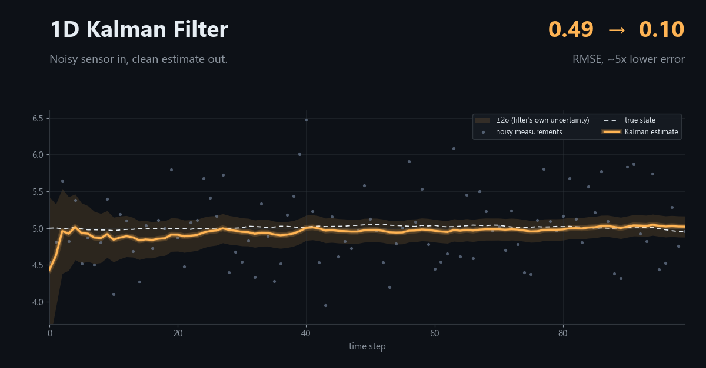
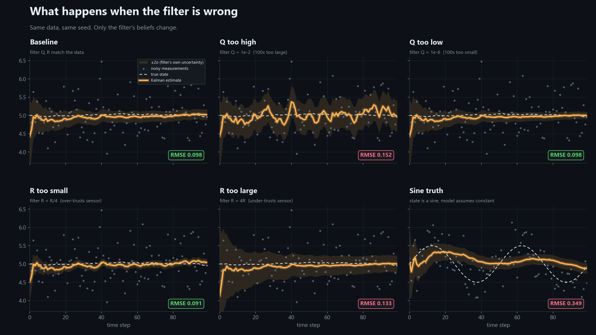
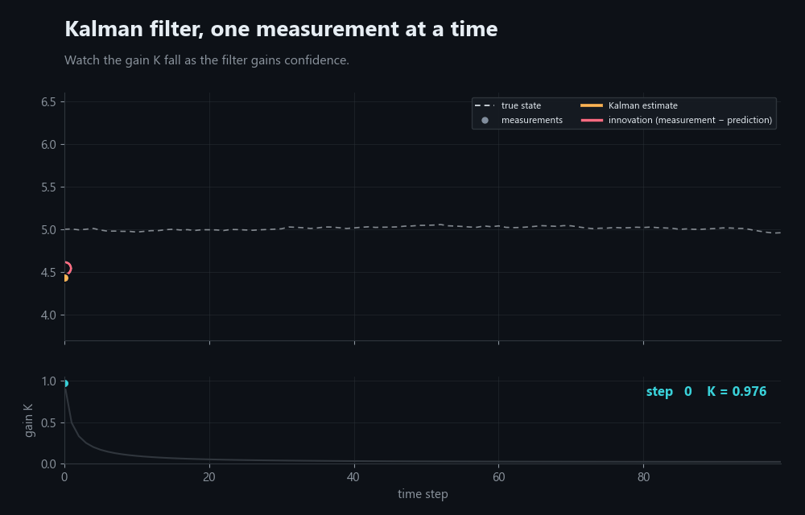
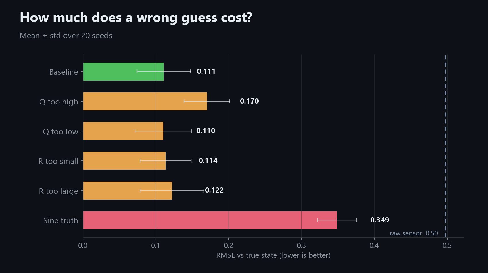
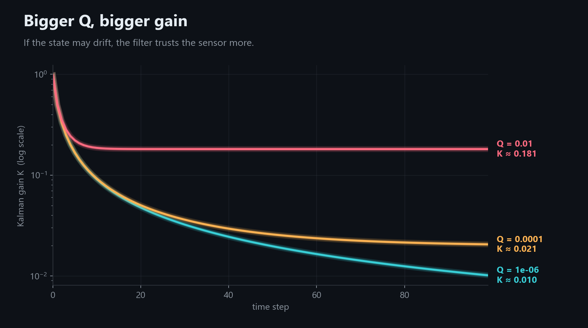

# 1D Kalman Filter: breaking it on purpose

A scalar Kalman filter in Python, tested on simulated data, plus a small experiment
suite showing what happens when the filter's assumptions are wrong.







## Model

- Process: `x_k = x_{k-1} + w_k`, `w ~ N(0, Q)`
- Measurement: `z_k = x_k + v_k`, `v ~ N(0, R)`
- Each step: **predict** (`P⁻ = P + Q`), **gain** (`K = P⁻ / (P⁻ + R)`),
  **update** (`x̂ = x̂⁻ + K·(z − x̂⁻)`, `P = (1 − K)·P⁻`)

## Results (20 seeds each, N = 100, true Q = 1e-4, true R = 0.25)

<!-- paste results/results_summary.md here after running -->

`rmse_steady` skips the first 20 steps so the deliberately bad initial guess
doesn't dominate.




## What I learned

<!-- write 3 findings in your own words after you've looked at the plots -->

## Run it

```
pip install -r requirements.txt
python experiments.py   # tables + figures in results/
python animate.py       # results/kalman.gif
```

## Next

Port the same filter to C on an STM32 and extend to the matrix (multi-state) form.
